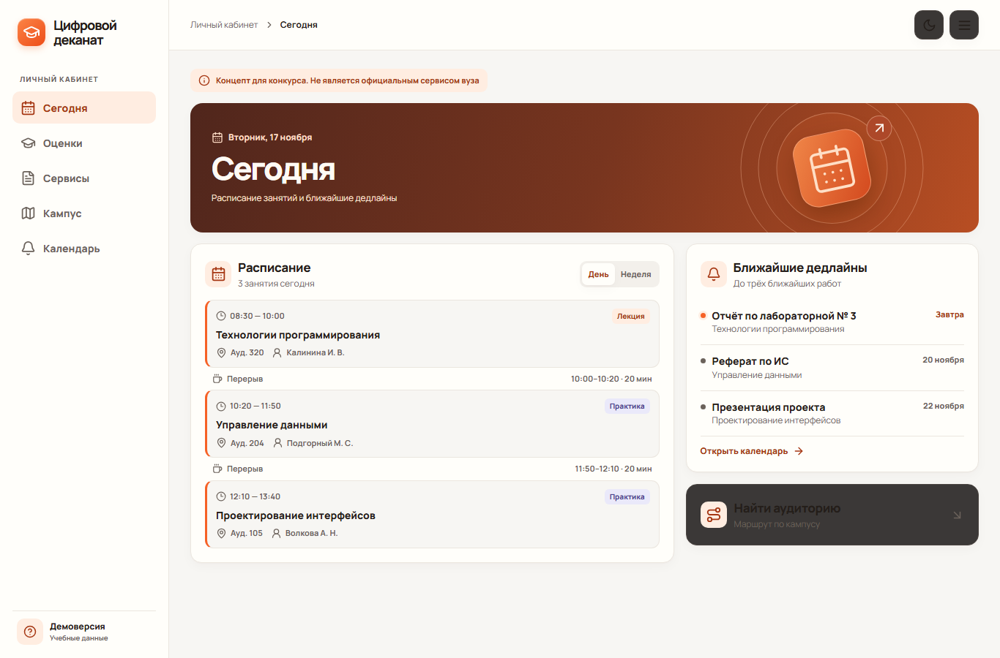
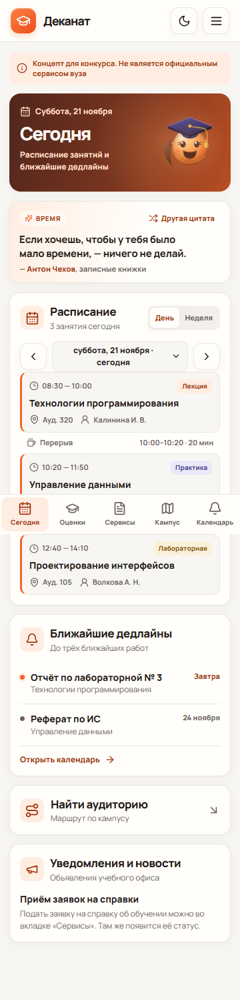

# Цифровой деканат

Мобильный конкурсный прототип на Next.js App Router, React, TypeScript, Tailwind CSS и компонентах по модели shadcn/ui. Личный кабинет использует Auth.js, Prisma и PostgreSQL.

## Скриншоты

Демоверсия `/demo/today` — личный кабинет на десктопе и в мобильном браузере:

<p align="center">
  
  
</p>

## Запуск демоверсии

Требуется Node.js 20.9+.

```powershell
npm ci
npm run db:generate
npm run dev
```

Откройте [http://localhost:3000](http://localhost:3000). Демоверсия по адресу `/demo/today` работает без PostgreSQL. Пример расписания привязан к текущей дате по Москве. Демозаявки и тема сохраняются в браузере. Схема кампуса условная.

## Личный кабинет и роли

Создайте пустую базу PostgreSQL, скопируйте `.env.example` в `.env` и заполните `DATABASE_URL`, `AUTH_URL` и `AUTH_SECRET`. Секрет можно сгенерировать командой `node -e "console.log(require('node:crypto').randomBytes(32).toString('base64'))"`. Затем задайте `DEMO_2FA_ENABLED=true`.

```powershell
npm run db:deploy
npm run db:user -- STUDENT student Имя Фамилия
npm run db:user -- STAFF office Имя Фамилия
npm run dev
```

Команда создания учётной записи запрашивает пароль в терминале и сохраняет только его bcrypt-хеш. После ввода верного пароля приложение показывает учебный шестизначный код. Код одноразовый, действует пять минут и допускает до пяти попыток. Подсказка на том же экране имитирует второй шаг входа. Для реального использования нужен отдельный канал доставки кода или другой второй фактор.

Студент входит через `/login`, сотрудник — через `/staff-login`. Сотрудник видит только закреплённые группы. Для ручной настройки создайте `StudyGroup` в Prisma Studio, у профиля `StudentProfile` заполните `group`, у `StaffProfile` — `groups`. Ранее созданные заявки со статусом `PROCESSING` сохраняются. Новые заявки получают статус «Новая».

## Сценарий для жюри

В пустой демонстрационной базе после миграций задайте `DEMO_ACCOUNT_PASSWORD` в локальном `.env` и выполните `node --env-file=.env scripts/create-demo.mjs`. Скрипт запускается вручную и создаёт один служебный аккаунт `demo-staff` и двух вымышленных студентов `demo-student-1` и `demo-student-2` в разных группах.

1. Войдите сотрудником и откройте «Заявки». Переведите заявку первого студента в «Готово», добавьте комментарий и срок. Заявка второй группы в кабинете сотрудника отсутствует.
2. Войдите первым студентом. В «Сервисах» видны статус, комментарий и срок, а в «Календаре» — уведомление. Скопируйте ссылку «Подробнее» и откройте её под вторым студентом. Сервер вернёт 403.
3. Сотрудником опубликуйте объявление для ДЕМО-101. Оно появится у первого студента. Второй студент его не получит. Аудитория «Все» включает все группы, закреплённые за сотрудником.
4. Сотрудником добавьте и перенесите занятие, выставьте балл и откройте «Аудит». У первого студента обновятся расписание и оценки, в календаре появится уведомление о переносе.

Миграции сами не создают демонстрационных записей. Схема кампуса условная, на ней доступны аудитории 105, 204 и 320.

## Проверки

```powershell
npm run typecheck
npm run build
```